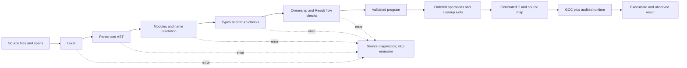
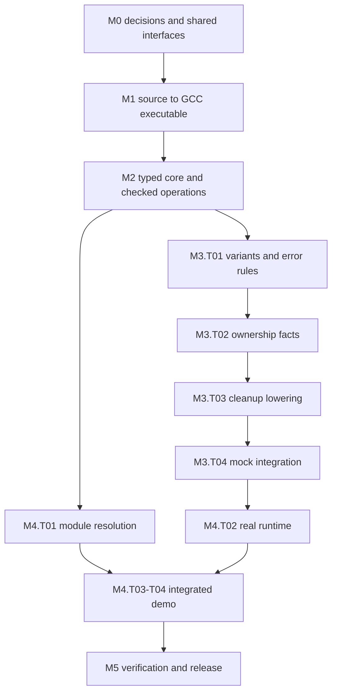

# C-- Engineering Roadmap

Roadmap for a three-person Review 2 prototype. This document specifies future work; it does not claim that a compiler, repository, tests, or safety guarantees already exist. No compiler implementation or scaffolding accompanies it.

## 1. Project interpretation and requirements baseline

Build a small C-- to C transpiler, compile its output with GCC, and demonstrate a precisely defined subset with successful execution, useful rejection diagnostics, and observable resource cleanup. Resolve semantics before the implementation that depends on them. First prove the compilation pipeline with an integer-returning program; then add the proposal's ownership, error handling, cleanup, and module features without introducing a general borrow checker.

### Evidence and authority

The supplied prompt is named `C--RoadmapPrompt.md` on disk; its title is “C-- Engineering Roadmap Prompt.” It is treated as the requested engineering-roadmap prompt despite the filename difference in the request. Its explicit constraints govern this plan.

The text of all ten slides in `C-- - A revolutionary language.pptx` and the complete `C-minus-minus_Review1_Script.docx`, including “Likely Teacher Questions and Answers,” was inspected. Citations below use **PPT slide N** and **Script — section title**. `inspo.md` was found beside the prompt and read only for planning structure. Its broader borrowing, dynamic-array, and tooling suggestions do not expand the proposal or override the no-full-borrow-checker constraint. The inspected source directory contains the prompt and two inspiration files, not an implementation repository; all paths below are proposed new paths.

Use these status labels throughout:

| Label | Meaning |
|---|---|
| **PC — proposal commitment** | Intent supported by the supplied proposal/script or explicitly preserved by the roadmap prompt. |
| **UD — unresolved design decision** | Team agreement is required before dependent implementation. |
| **RC — recommended choice** | A provisional engineering recommendation, not an adopted requirement. |
| **PA — planning assumption** | A reversible assumption used to make assignments and estimates concrete. |
| **CV — claim to validate** | A hypothesis or promotional claim requiring evidence. |

Unless otherwise marked, the detailed language contract, architecture, tasks, commands, tests, and release gates below are **RC**. Each decision-register row is **UD**, with a proposed **RC** answer. Assignments and estimates are **PA**. Adoption must be recorded in `docs/decisions.md`; this roadmap itself does not adopt decisions for the team.

### Requirements and evidence

| ID | Baseline and status | Evidence | Prototype treatment and remaining gap |
|---|---|---|---|
| R01 | **PC:** Programmer-facing systems language; familiar C/C++-like syntax; safety by removal. Performance, predictability, and low-level control are goals. | PPT 2, 4, 7, 8; Script — Slides 2, 4, 8 | Preserve `module`, `fn`, braces, `let`, `mut`, `Result`, `?`, and `defer`. M1–M5 demonstrate a small hosted subset; hardware access and broad systems suitability remain unproven. |
| R02 | **PC:** Ownership replaces manual memory management; one owner, scope-end release, no aliases of owned values; full borrow checker excluded. | PPT 4, 8, 9; Script — Q&A “How is ownership enforced without a borrow checker?” | M3 implements moves and automatic cleanup with no first-class references. M4 supplies a real owned file. Heap containers remain a later extension. |
| R03 | **PC:** No source raw pointer arithmetic or null pointers; `Option` represents absence. | PPT 4, 8, 9; Script — Slides 8, 9 | M2 rejects pointer/null syntax; M3 adds `Option<int>`. Runtime C pointers stay behind audited wrappers. |
| R04 | **PC:** Explicit errors through `Result`; `?` propagates upward. | PPT 8, 9; Script — Slide 8 | M3 adds must-handle results and propagation. No exceptions or general error-type conversions. |
| R05 | **PC:** Built-in `defer`; example file closes on function exit. | PPT 8; Script — Slide 8 example explanation | M3 defines cleanup ownership and ordering; M4 verifies closure on success and recoverable error. Nested-block registration and trap cleanup are restricted explicitly. |
| R06 | **PC:** Immutable default; `mut` enables assignment. | PPT 4, 8, 9; Script — Slide 8 | M2 enforces binding mutability. File cursor effects are a separately documented runtime operation. |
| R07 | **PC:** Modules replace source headers and preprocessor. Compact language. | PPT 8, 9; Script — Slide 8 | M1 accepts one module; M4 resolves local acyclic imports. No source includes/macros. Generated C may use headers internally. |
| R08 | **PC:** C-- → C → GCC, planned for Review 2. | PPT 4; Script — Q&A “How will you implement it?” | M1 onward. LLVM, direct code generation, self-hosting, and alternate backends excluded from the initial path. |
| R09 | **PC:** Removing undefined behavior is a design objective. **CV:** “None” in the comparison table. | PPT 4, 9; Script — Slide 9 | M2 defines arithmetic; M3–M5 audit lowering and runtime. Claim only a specified, tested subset under a stated trusted boundary. |
| R10 | **CV:** Novelty, research gap, literature-survey comparisons, and roughly 70% memory-security statistic. | PPT 3, 5–7, 10; Script — Slides 3, 5–7 and Q&A | M5 builds a claim ledger with primary evidence, dates, and populations. Do not repeat the broad comparisons or percentage as verified facts. |
| R11 | **CV:** One-page grammar, learnable in an afternoon, near-C performance and mostly bounds-check overhead. | PPT 8; Script — Slide 8 and performance Q&A | M5 reports grammar size, a small learning exercise, and limited benchmarks if feasible. Arrays are excluded initially, so bounds-check overhead is not a demonstrated explanation. |
| R12 | **PC:** Three named contributors. **CV:** Existing C-- naming collision acknowledged. | PPT 1, 6; Script — title and naming Q&A | Assign Ronit Mexson, Garv Gupta, and Mit Kumar Raju Panchal provisionally. Add a naming note in M0; no rename dependency for the prototype. |

### Ambiguities and tensions to resolve

| Evidence | Ambiguity or tension | Engineering consequence and proposed resolution |
|---|---|---|
| PPT 8 uses `let x`, `mut count`, and `file f`. | Is `file f` a different declaration form? Is it mutable? | D02: preserve `file f = expression;` as immutable typed shorthand, also permit `let f: file = expression;`; normalize both to the same AST declaration. |
| PPT 8 uses `Result<int>`. | The error type is absent. | D08: one fixed built-in `Error` type for the prototype; `Result<T>` means that error type. |
| PPT 8 calls unqualified `open` and `close`. | No origin, signatures, ownership effects, or failure model are given. | D13: a small documented prelude from an audited runtime, not arbitrary C functions. |
| Script Q&A says scope-end freeing; Script Slide 8 promises function-exit deferred closure. | Ordinary block destruction and function-exit `defer` can collide or close twice. | D09: automatic lexical destruction by default; accepted `defer close(f)` reserves that same obligation for function exit, never creates a second close. Restrict registration to the outer function body initially. |
| Script excludes a full borrow checker; inspiration suggests borrowing and collections. | General references would add a major analysis and soundness burden. | D07: exclude references, slices, closures, and owned aggregates. Permit only named, live file access by audited non-escaping intrinsics. |
| PPT 9 says undefined behavior is absent; semantics are incomplete. | C emission could introduce overflow, unsequenced effects, or invalid accesses. | D10–D12: define or exclude each operation and audit emitted C. The table is an objective to validate, not evidence of safety. |
| PPT 8 simplicity claims and Script performance explanation. | Neither a complete grammar nor measured performance is supplied. | Preserve them as CV, report prototype limits, and avoid enlarging the MVP to support the claims. |

The sources agree on the core implementation path. The issues above are specification gaps and overbroad claims, not permission to redesign the project into Rust, a garbage-collected language, or a C++ replacement.

## 2. Decisions and MVP contract

### Prioritized decision register

Owners below draft decisions; reviewers challenge counterexamples. All three contributors approve shared semantic and interface contracts before implementation. **R = Ronit Mexson; G = Garv Gupta; M = Mit Kumar Raju Panchal.** These roles do not imply skills inferred from presentation speaking parts.

| ID / priority | Question and viable options | Recommended minimal choice and rationale | Constraints preserved | Owner / reviewer | Validation experiment and blocked gate |
|---|---|---|---|---|---|
| D01 / P0 | Which spelling, tokens, literals, and grammar? ASCII or Unicode identifiers; handwritten or generated grammar? | ASCII identifiers, UTF-8 files, decimal integers, ASCII string contents with limited escapes, braces/semicolons, `//` and non-nesting `/* */` comments. Write compact EBNF plus precedence table. | C-like surface, small grammar, precise diagnostics. | R / G | Hand-parse slide 8 and ten malformed fragments, including unterminated strings/comments. Blocks M1.T02. |
| D02 / P0 | Declaration forms, initialization, scope, and mutability? Inference only or annotations; late initialization or mandatory initializer? | `let n[: T] = e;`, `mut n[: T] = e;`, plus slide-compatible `file n = e;`. Require initializer; lexical scope; no local shadowing in the prototype. Parameters immutable. | Slide 8 remains explainable; immutable default; no uninitialized reads. | R / M | Normalize all declaration forms; reject duplicate/shadowed names and missing initializers. Slice needs only the no-local subset. Blocks M2.T01. |
| D03 / P0 | Which values are in scope? Many numeric widths, arrays, structs, heap strings, or a narrow set? | Signed 32-bit `int`, `bool`, `unit`, literal-only `str`, opaque owned `file`, fixed `Error`, and a closed set of Option/Result instances. No arrays or user aggregates. | Compactness, ownership and absence/errors without general generics. | G / R | Make an accepted/rejected type inventory and representation table. Blocks M1.T03 for `int`; M2.T01 and M3.T01 for the rest. |
| D04 / P0 | Precedence, conversions, and order of effects? C order, explicit order, coercions? | Left-to-right operand and argument evaluation; short-circuit boolean operators. Exact type equality, no implicit integer/bool/string conversions or casts. Assignment is a statement. | Predictable behavior and small semantic surface. | G / M | Trace two effectful arguments and short-circuit branches by hand; arithmetic precedence fixtures. Blocks M2.T01–T02. |
| D05 / P0 | Functions, entry point, returns, and control flow? Recursion and all C statements, or restricted structured flow? | Explicit parameter/return types; direct calls, `if`/`else`, primitive-only `while`, `break`/`continue`, statement `match`; no recursion initially. `main()` returns `int` or `Result<int>`. | Minimal runnable subset; explicit control/return checking. | R / G | Trace all-path return analysis; reject call-graph cycles and missing returns. Freeze exact integer entry status before M1.T03; other rules block M2.T02. |
| D06 / P0 | Moves, reassignment, merge states, and loops? Reject all joins or track ownership? | Per-binding flow states; consume file/Result on assignment, ordinary call, match, and return. Conservative joins; mutable replacement drops the old value once. Owned values excluded from loop bodies except untouched outer bindings. | Single owner, no full borrow checker, scope cleanup. | G / R | Enumerate state transitions and branch/loop counterexamples in a table before implementation. Blocks M3.T02. |
| D07 / P0 | How can resources be used without aliases? No access; general borrows; special effects? | No address-of/dereference or first-class references. A fixed runtime signature table allows synchronous access to a named live file; it cannot retain or return an alias. All user file parameters consume. | No aliases of owned values, useful files without lifetime inference. | G / M | Review `use(f,f)`, returned aliases, storage in aggregates, and access after move. Audit each wrapper against its declared effect. Blocks M3.T02 and M4.T02. |
| D08 / P0 | Option/Result construction, matching, `?`, and discard? General enums/errors or built-ins? | Tagged built-ins, one fixed `Error`, exhaustive two-arm statement matches; all Result values move-only and must be discharged. Forbid explicit discard. `?` accepts Result only in Result-returning functions. | Mandatory errors and no null. | G / R | Truth table for Ok/Err propagation and Some/None; enumerate all paths leaving a live Result obligation. Blocks M3.T01. |
| D09 / P0 | What does `defer` capture, when does it run, and who owns destruction? Arbitrary closures; consuming capture; pinned owner? | Support only `defer close(f);` at function-body top level. Bind to that live local's ownership slot immediately, pin against move/reassignment, and transfer its automatic cleanup obligation to the function's deferred list. LIFO deferred actions, then remaining locals. | Function-exit intent, exactly one owner and one cleanup obligation. | M / G | Trace normal/early return, `?`, two files, registration not reached, duplicate registration, and move-after-registration. Blocks M3.T03. |
| D10 / P0 | What do arithmetic, invalid indices, and traps mean? Wrap, reject, or check? | Checked 32-bit arithmetic; compile-time rejection of invalid constant operations; runtime traps for corresponding dynamic failures. Exclude shifts, bitwise operations, arrays, and indexing initially. | Defined subset, explicit boundaries, no accidental C behavior. | M / G | Boundary table at min/max, zero, and division overflow; verify checks precede dangerous C operations. Blocks M2.T03. |
| D11 / P0 | Which target, C dialect, and ABI? Cross-platform or one host? | C11 on one x86-64 Linux GCC environment, exact Python/GCC/OS versions pinned by team; hosted single process. Require 8-bit bytes and available `int32_t`/`int64_t`. Internal ABI only. | GCC path with reproducible assumptions. | M / R | Record tool versions and compile a future environment probe in M1; confirm actual GNU GCC. Blocks M1.T04. |
| D12 / P0 | Allocation, release failures, and trap cleanup? GC, public allocation, or confined runtime? | No language heap allocation; file runtime may allocate internally. Open/read failures become Result. Release failure is a documented fatal runtime cleanup fault after remaining scheduled cleanups are attempted. General traps do not unwind. | No manual freeing or GC; honest cleanup boundary. | M / G | Fault-inject open/read/close and verify result/trap classification and counters. Blocks M3.T03 and M4.T02. |
| D13 / P1 | Module resolution and origin of I/O names? Package system, implicit C linkage, or local modules? | Project-root-local `.cmm` modules with `import util;` and `util::fn(...)`; acyclic imports. Explicit prelude entries `open`, `read_byte`, and `close` with reserved names. | Modules replace headers; no unrestricted C interop. | R / M | Two-module demo, missing/duplicate modules, import cycle, and runtime name collision. Blocks M4.T01. Prelude signatures needed at M3.T01. |
| D14 / P0 | Implementation stack and shared representations? Python/C++/Rust; parser generator/handwritten? | Python with standard library, recursive descent for declarations/statements, precedence climbing for expressions; typed AST plus small cleanup-oriented lowering. | Small team effort and inspectable semantics. | R / M | Short team skills check; review AST and lowering records on paper. Blocks M0.T03 and M1.T01. |
| D15 / P0 | Review date, available hours, grading expectations, and required platforms? | Assume 8 focused hours/person/week, one Linux demo environment, six milestone gates, no externally fixed date. Review acceptance must include negative tests. | Realistic estimates; no invented expertise or deadline. | R / G | Ask team/guide to confirm availability and rubric, then recompute capacity. Blocks calendar commitments, not document planning. |

D01, the slice portions of D03/D05, and D11/D14 must be adopted before M1. Settle D02/D04/D10 before M2; settle D06–D09/D12 and prelude signatures before M3. Resolve D13 fully before M4. An unresolved semantic issue blocks that feature, rather than being decided accidentally in the emitter.

### Exact proposed subset

**RC — Lexical and declaration contract.** Identifiers match `[A-Za-z_][A-Za-z0-9_]*` and are case-sensitive; keywords and prelude names are reserved. Spaces, tabs, LF/CRLF, and comments separate tokens. Source files are UTF-8; non-ASCII text may appear in comments, but identifiers and string contents are ASCII initially. Integers are unsuffixed decimal; floats, character literals, numeric separators, hexadecimal, and implicit concatenation are rejected. Strings support `\n`, `\r`, `\t`, `\"`, and `\\`; embedded NUL is rejected. A minus sign is an operator; constant analysis recognizes `-2147483648` as the minimum `int` without first narrowing its positive magnitude. Each declaration has an initializer. Type annotations must match; constructor types may be inferred from an annotated binding, return type, or call parameter. Ambiguous `None`, `Ok`, or `Err` expressions require context.

There is one `module name;` declaration first, followed by imports and functions. Local names cannot shadow an active local/parameter; nested scope reuses after a scope ends are allowed. No global variables or initialization order. Function parameters use `name: Type`, commas separate arguments, and a return type follows `->`. Braces are mandatory. `return expression;` is mandatory on all reachable paths of value-returning functions; `return;` or fallthrough is allowed only for `unit`.

**RC — Types and operators.** The full Review 2 whitelist is:

| Kind | Accepted values and operations | Limits |
|---|---|---|
| `int` | −2^31 through 2^31−1; `+ - * / %`, unary `-`, equality/order comparisons | No other integer widths, casts, shifts, bitwise operations, increment/decrement, or compound assignment. Division truncates toward zero; remainder follows dividend sign. |
| `bool` | `true`, `false`, `!`, `&&`, `\|\|`, `==`, `!=`; conditions require bool | No C-style integer truthiness. |
| `unit` | `()` as value; no-result functions; `Result<unit>` payload | No arithmetic or comparisons. |
| `str` | Immutable string literals and their copied handles; pass to `open` | Static program lifetime, no heap ownership, indexing, concatenation, mutation, equality, or user-provided C strings. |
| `Error` | Fixed copyable values `Error::NotFound`, `Error::Permission`, `Error::Io`; equality | Runtime maps platform error numbers to these values; raw `errno` is not exposed. |
| `file` | Opaque, move-only owner; acquisition, transfer, synchronous runtime access, automatic release | Read-only files; no numeric handles, duplication, pointer operations, writes, seeks, or user constructors. |
| `Option<int>` | `Some(int)`, `None`, exhaustive match; copyable | No direct payload access, unwrap, or arbitrary Option nesting. |
| `Result<int>`, `Result<unit>`, `Result<file>`, `Result<Option<int>>` | `Ok(payload)`, `Err(Error)`, exhaustive match, `?`, move/return | All Result instances are move-only obligations even when their payload is copyable. No user-defined generic types. |

Precedence, highest to lowest: calls/qualified names/postfix `?`; unary `- !`; `* / %`; `+ -`; `< <= > >=`; `== !=`; `&&`; `||`. Binary operators associate left except comparison/equality chains, which are rejected unless parenthesized with valid types. Parentheses override precedence. Assignment `name = expression;` is outside the expression grammar and requires `mut`. Operands and arguments evaluate left to right; `&&`/`||` evaluate their right operand only when required. No operator overloading or implicit conversion.

`if (condition) { ... } else { ... }`, `while (condition) { ... }`, `break;`, and `continue;` are supported. Loops may operate on primitives and literal strings only: no file/Result declaration, access, transfer, reassignment, `?`, or defer inside a loop body. Outer owned values may remain untouched across a loop. This intentionally conservative rule avoids claiming a general loop ownership analysis. Recursion, including indirect call cycles, is rejected; call graphs must be acyclic. Exhaustive `match` is a statement with exactly the two appropriate variant arms, braced bodies, distinct bindings, and no guards, wildcard, or fallthrough. Match-bound values are immutable. Ordinary function calls and control flow grow in M2; built-in matches grow in M3.

### Ownership and cleanup contract

**RC — Ownership states.** For each file or Result binding, track `Live`, `Moved`, or `MaybeMoved`, with lexical scope and an optional cleanup reservation. Primitive copies duplicate a value; they do not create owned aliases. A Result's move-only property tracks the duty to handle it, even if the active payload is just an integer or error. `let g = f`, a user-function argument, and `return Ok(f)` transfer ownership and invalidate the old binding. Evaluating two consuming arguments involving the same owner rejects the second use. `match` and `?` consume a Result; an Ok file payload becomes a new owner only on that branch. Matching a copyable Option does not consume it.

At a branch join, equal states remain equal; Live/Moved joins become MaybeMoved. Later read, access, transfer, or defer registration on MaybeMoved is rejected. Automatic file destruction uses a compiler-owned live flag so a file moved on only one branch is closed only on the other. A Result may not leave scope Live or MaybeMoved: every path must handle it. Returning branches do not participate in joins with continuing branches. A `mut` file can be reinitialized from Moved/MaybeMoved or replace a Live file: evaluate and own the right side first, release the old value if live, then install the new value. Self-move assignments and all replacement of pinned files are rejected. A live/maybe-live Result may not be overwritten to erase an unhandled error; after consumption, a mutable Result slot may receive a new obligation.

**RC — No user aliases.** There is no source address-of, dereference, reference type, slice, closure capture, aggregate field, or global slot into which an owner can escape. User-defined functions take owned arguments by value, so passing a file consumes it. Returning ownership is allowed through `Result<file>`. Raw `file` returns are excluded to keep the closed API small. All ownership-carrying wrappers move; C struct assignment must never be mistaken for a source copy.

The one restricted access facility is the built-in `read_byte(f)`, which requires a simple live file binding. It operates synchronously on that slot and retains nothing. It returns only a copied byte or EOF/error, never a file alias. This is an intrinsic effect checked by the compiler, not a first-class borrowing feature. A file's cursor may change even through an immutable binding: immutability prevents rebinding the owner, not external I/O state changes. The documentation must make this distinction explicit. Adding any wrapper that retains a handle, calls user callbacks, or returns interior data requires a new decision and tests.

**RC — Automatic destruction.** Every successfully created file has exactly one cleanup obligation. Lexical scope exit releases live, unreserved files in reverse declaration order; replacing a mutable binding does not change its position in that order. Moves transfer the obligation. Return values are evaluated and moved into a protected return slot before local cleanup; returned resources are not destroyed as locals. Branch-local resources are released on leaving that branch. Owned parameters precede locals in declaration order. Unconsumed owned expression temporaries clean up in reverse evaluation order on an early error exit. Discarding a bare file temporary is rejected so ownership is always attached to a binding, parameter, Result, tracked expression temporary, or return slot.

**RC — Restricted `defer`.** Initially, the only accepted form is `defer close(f);`, where `f` is a definitely live local file declared in the outer function body. The statement must itself appear directly in that body, not inside a block, branch, loop, or match arm. The registration happens when execution reaches the statement; an earlier return creates no registration. It captures the binding's ownership-slot identity immediately, not its value at exit, and pins that slot. The file remains usable through permitted runtime access, but cannot be moved, returned, reassigned, or registered again. No arbitrary deferred calls or late-bound expressions are supported.

Registration transfers the existing automatic cleanup obligation to a function-exit list. It does not copy the resource or add another destructor. On normal return, implicit unit return, or propagation through `?`, first release owned expression temporaries and resources in nested scopes being exited, then execute reached deferred registrations in LIFO order, then release other live function-scope resources in reverse declaration order. Each executed release clears its live/cleanup state. Without registration, automatic destruction still closes the file. `close(f)` is not a standalone manual-free operation in the prototype; it is a cleanup intrinsic allowed only in this defer form.

`break`/`continue` do not run function defers. The loop restrictions above prevent loop-local ownership cleanup or defer accumulation in this version. Nested-block defer is rejected rather than silently given block-exit behavior inconsistent with the script. Expanding this restriction later needs a bounded representation or a carefully owned dynamic defer stack.

**RC — Errors, traps, and release failures.** Open/read errors are recoverable Result values. A cleanup wrapper attempts each release exactly once; it clears the obligation even on failure and must not retry a possibly consumed handle. If release reports failure, enter a fatal cleanup exit: attempt all remaining active cleanup obligations in the current function, including expression temporaries and any protected return resource that will no longer be returned, then terminate with the documented trap status. This also applies to release during mutable replacement or block exit. It does not unwind callers. This is a deliberate restriction: there is no recoverable close-error API or file writing in the prototype. The team must approve it in D12; otherwise propose an explicit fallible-finalization design before implementing file output. Do not claim that an OS-level close can always succeed.

Arithmetic traps and internal runtime faults terminate with a diagnostic and status 70; they do not unwind or guarantee cleanup. Process termination, signals, hardware faults, and external kills likewise have no cleanup guarantee. The script's “guarantees” must therefore be qualified as exactly-once cleanup attempts on normal and recoverable-error exits under the runtime contract. If the guide requires cleanup on every trap, treat that as a scope change with a separate unwinding design, not a hidden promise.

### Option, Result, and propagation contract

**RC:** Each supported Option/Result is represented by a tag and storage for the active payload; inactive fields are never read. There are no sentinel null payloads. Only constructors, exhaustive match, and the defined Result `?` operation inspect these values.

`Result<T>` means success with `T` or failure with the fixed `Error` type. Mandatory handling means every Result-producing expression is bound to a tracked obligation, transferred into a checked consuming parameter, returned, exhaustively matched, or consumed by `?`. Binding or transferring a result moves the duty to its new owner; it is not itself handling the error. Neither `_ = expression` nor a discarded expression statement discharges it. An Err match arm may explicitly return another error, return a documented fallback success, or continue recovery; entering that explicit arm counts as handling. Copying or overwriting an unhandled result is forbidden. This includes expression temporaries: reject a call whose earlier Result argument would remain unhandled if a later argument's `?` returned early. A file temporary can be automatically released on that path, but an unhandled Result cannot simply be destroyed to erase its error.

`expression?` evaluates once. In an enclosing `fn ... -> Result<U>`, Ok extracts/moves the `T` payload into the expression result; Err preserves its Error, runs the relevant cleanup path, and returns `Err(error)` of the enclosing `Result<U>`. T and U need not match; Error must match the single supported model. `?` on Option, on a primitive, or inside an `int`/`unit`-returning function is rejected at the question mark. No unwrap or error conversion is implicit. Returning Result transfers the obligation to the caller; the generated entry wrapper is the final handler for `main`.

### Defined operations and trusted boundary

| Operation / hazard | RC classification | Defined rule or boundary |
|---|---|---|
| Out-of-range literal, invalid constant arithmetic | Statically rejected | Diagnose the literal/operator, even in otherwise unreachable code; no silent wrapping. |
| Dynamic `+`, `-`, `*`, unary minus | Runtime checked | Compute in signed 64-bit space from checked 32-bit operands, range-check before narrowing. All such intermediate arithmetic fits 64 bits. |
| `/`, `%` | Runtime checked | Check zero divisor and `INT32_MIN / -1` (also remainder counterpart) before evaluation; trap on either. |
| Evaluation order / short-circuit effects | Defined by lowering | Sequence separate temporaries; preserve skipped branches. Never rely on C argument order. |
| Initialization, moves, duplicate owned arguments, unhandled results | Statically rejected | Frontend stops emission on invalid programs; runtime flags supplement valid lowering, not acceptance of invalid reads. |
| Null, source pointers, pointer arithmetic, casts, shifts, bitwise operations | Excluded | Report unsupported-feature or type diagnostics at the operation. |
| Arrays, indexing, buffers, aggregate aliases | Excluded | No user bounds operation exists initially; index syntax is rejected. Future arrays require length representation and checks before every access. |
| File acquisition/read and EOF | Result / Option | `open` maps failures to Error; read failure is Err; EOF is `Ok(None)`; a byte is `Ok(Some(0..255))`. |
| File cleanup failures | Specified fatal runtime fault | Attempt remaining scheduled cleanup, then trap; no recoverable source close API. |
| Allocation | Restricted runtime boundary | No source allocator or dynamic container. C library allocation during `open` is mapped to acquisition failure; no custom runtime allocation in the initial design. |
| Recursion, stack/resource exhaustion, external termination | Recursion excluded; external limits documented | Acyclic calls reduce exposure but do not prove freedom from host failure. Runtime/OS exhaustion is outside the semantic safety claim where it cannot be reported. |

C's expression rules permit undefined behavior on exceptional arithmetic and do not supply the proposed source sequencing contract. The checks and lowering above are design obligations, not consequences of choosing C. The relevant baseline is the [C11 committee draft, §§6.5, 6.5.2.2 and 6.5.5](https://www.open-std.org/jtc1/sc22/wg14/www/docs/n1570.pdf).

**RC — Safety statement to target, not yet achieved:** Accepted programs in this restricted subset have statically enforced ownership and Result obligations, no source null/pointer operations, checked integer operations, tag-checked variant access, and exactly-once resource cleanup attempts on normal and recoverable-error paths. This relies on correct frontend analysis, lowering, generated C, runtime wrappers, GCC, C library, and host. Compiler-generated pointers inside audited wrappers are allowed; source-language pointer operations are not. No soundness proof, arbitrary C interop guarantee, hostile-input security guarantee, or production readiness is implied. Unsupported constructs must be rejected explicitly.

**PA — Environment:** one hosted x86-64 Linux environment, C11, 8-bit bytes, fixed-width 32/64-bit integers, and a C library with standard file I/O. The runtime and generated C compile together using one GCC toolchain, so there is no promised stable public ABI. No endian-dependent serialization or external struct layout is exposed. A Linux VM or lab machine is a possible team choice; this roadmap does not assume the user's current machine matches the target.

## 3. Architecture and tooling

### Pipeline and component contracts

**RC:** An AST is the parsed structure of the program. A typed AST adds resolved names, types, and ownership effects. A small lowered representation makes evaluation steps and cleanup exits explicit so the C emitter does not have to rediscover language rules. Start with direct emission from the checked AST in M1; introduce only the lowering records needed for control flow in M2 and cleanup in M3. Do not build SSA, an optimizer framework, or a general-purpose IR toolkit.



Use a shared `Span(file_id, start_offset, end_offset)` on tokens, AST nodes, and lowered operations. Store UTF-8 byte offsets and derive displayed 1-based line/column from source text; columns count Unicode characters with a documented tab-display width. Primary diagnostics point to the failing token, with secondary notes at the declaration, move, or cleanup registration. Compiler-generated operations inherit a source span and a generated-origin label. Source spans remain valid after lowering; do not fabricate source locations from C line numbers.

| Component / proposed file | Responsibility and input → output contract | Dependencies and handoff | Location handling and tests |
|---|---|---|---|
| Driver — `cmm/cli.py`, `cmm/__main__.py` | Parse check/build/run options; source path + target settings → compilation result, artifacts, or structured failure. Execute GCC with an argument list, no shell interpolation. | First shell of workflow in M1; orchestrates all passes. | Preserve invoked source paths; test missing file, invalid command, GCC absence, execution failure. |
| Source/diagnostics — `cmm/source.py`, `cmm/diagnostics.py` | Bytes → validated source object and line index; diagnostics → stable code, message, span, notes. | M0 interface shared by every component. | T01–T02: CRLF, tabs, invalid encoding, exact token positions. |
| Lexer — `cmm/lexer.py` | Source → tokens including EOF, text/value, span; reject malformed literals/comments. | D01, source contract. | Preserve opening delimiter for unterminated constructs; token fixtures and malformed-input termination. |
| Parser/AST — `cmm/parser.py`, `cmm/ast.py` | Tokens → syntactic AST; precedence and braced structure; limited recovery at `;`/`}`. | Lexer and D01/D02/D04. | Span compound nodes and operators; T02 grammar, associativity, missing delimiters. Cap cascades, never emit on parse errors. |
| Modules/names — `cmm/resolve.py`, `cmm/modules.py` | ASTs + prelude → module graph, symbol IDs, resolved declarations/calls. | Single-module M1; full D13 graph M4. | Import token and cycle path diagnostics; duplicate declarations and unknown-name tests. |
| Type/return checks — `cmm/types.py`, `cmm/typecheck.py` | Resolved AST → typed AST and call signatures; reject invalid types, mutation, match, `?`, and missing returns. | D02–D05, D08; runtime signature table. | T03–T06/T11–T12; report actual/expected types at expressions and return sites. |
| Flow/ownership — `cmm/flow.py` | Typed AST → ownership states, Result obligations, scope cleanup facts; validate branches, loop restrictions, and moves. | Types, structured control-flow edges, D06–D09. | T07–T10/T13–T15; show original owner/move/defer span. No bypass in build mode. |
| Validated-program boundary — `cmm/checked.py` | Type/flow success → emitter-eligible program record. Any error → no record. | All frontend checks. | Test that build never invokes GCC after any source error. Internal invariant failures are compiler bugs, not user diagnostics. |
| Lowering — `cmm/lower.py` | Validated AST/facts → ordered temporary operations, branch targets, moves, tags, cleanup and return exits. | Semantic decisions and shared slot IDs. | Retain originating spans; snapshot small control-flow traces, test branch joins and early-exit cleanup. |
| C backend — `cmm/emit_c.py` | Lowered program → one C translation unit plus C-line-to-source map. Emit fixed-width types, checked arithmetic, internal name mangling, no unchecked variant reads. | Lowering contract and runtime ABI. | T16/T19/T20; compile with warnings-as-errors; inspect meaningful emitted patterns rather than brittle whole-file snapshots. |
| Runtime — `runtime/cmm_runtime.h`, `runtime/cmm_runtime.c` | Fixed wrapper ABI → open/read/release, tags, diagnostics, test-only event hooks. No user callbacks or retained aliases. | D11–D13; mock contract in M3, real wrappers in M4. | Carry source-site IDs to checks; T13–T17/T21; fault injection and sanitizer runs. |
| GCC/run adapter — `cmm/toolchain.py` | Generated paths + settings → executable or backend failure; executable → output/status/timeout result. | M1 target probe, runtime as introduced. | Retain GCC stderr, version, command arguments, source map and exit status. Distinguish GCC bugs/emission failures from language diagnostics. |
| Test runner — `tests/test_*.py`, `tests/cases/` | Source + expected diagnostic/output/events → isolated check/build/run assertions. | Interface fixtures from M0; grows at every milestone. | Temporary working directories, fixed fixtures, deterministic seeds, timeouts, and stored failing artifacts. |

**RC — Error boundary:** Lexical, parse, resolution, type, and ownership errors accumulate only enough diagnostics to be useful, then prevent C emission and GCC invocation. A partial AST with errors never becomes a validated program. GCC is a backend validation tool, not the type checker or ownership checker. If validated C-- produces invalid C, report a backend failure with retained C and GCC output; do not relabel it as a source-language error.

### Lowering invariants

Agree these in M0.T03 and test each as its feature arrives:

1. **Evaluate once in order.** Store each effectful operand/call argument in a temporary before its consumer. Keep short-circuit operations as conditional branches. Tag construction happens after payload evaluation succeeds.
2. **Move ownership explicitly.** Moving an owned value clears the source live flag and gives one destination slot the obligation. The temporary used during transfer is itself accounted for; an error in a later argument must clean earlier temporaries. Primitive copies never create cleanup obligations.
3. **Inspect active tags only.** Branch on Result/Option tags before reading the corresponding payload. `?` branches to success continuation or the enclosing error-return cleanup path. An inactive union member is never evaluated.
4. **Route exits through known cleanup.** Evaluate a return value first and protect its moved payload. On `return` or `?`, clean exited scopes and the function according to D09, then return the protected value. Each live flag becomes false when its obligation transfers or releases. Branch-local cleanups happen at their own scope exits.
5. **Reserve, do not duplicate.** A deferred resource is removed from ordinary function cleanup scheduling. Top-level-only registrations have a static maximum count; registration flags distinguish actions actually reached from actions skipped by early return. No dynamic allocation is needed for the defer list.
6. **Check before unsafe C operations.** Perform range/divisor/tag checks before narrowing, arithmetic, or payload access. `int32_t` values are promoted deliberately to `int64_t` for checks. Use typed C members, not pointer punning. Runtime-internal null results are converted immediately to tags/errors and never exposed to C--.
7. **Do not hide diagnostic failures.** Keep source spans on all checks and cleanup sites. Avoid broad GCC warning suppressions. Legal unused source bindings, including slide 8's `x`, may be marked intentionally unused in generated C after evaluating them; this must never suppress the frontend's unhandled-Result rule.

### Implementation and parser choices

| Candidate | Fit for this prototype | Cost or tradeoff |
|---|---|---|
| Python | **RC:** Fast to change grammar/semantic records; standard-library dataclasses, enums, subprocess and unittest are sufficient. | Dynamic implementation errors need strong invariants and tests. This choice says nothing about generated program performance. |
| C++ | Viable if all three already use it confidently; explicit data structures and static types. | More implementation lifetime/build concerns for a project whose difficult part is language semantics. Do not adopt solely because C-- looks C-like. |
| Rust | Viable with existing team fluency; static types can make compiler invariants explicit. | Learning the implementation language while designing ownership rules can consume the schedule. Choosing Rust would not require a full borrow checker in C--. |

**PA:** The team can work in Python or learn the small required subset quickly; verify this before accepting D14. Recommend a pinned supported Python 3 version with dataclasses, a handwritten recursive-descent parser for statements/declarations, and a small precedence-climbing expression parser. A parser generator is viable if already familiar, but adds grammar/tool dependencies and generated-parser diagnostics to learn. The handwritten choice requires an explicit precedence table and parsing tests; “small” does not mean ad hoc string splitting.

Use `unittest`, standard-library temporary directories, a seeded property-test driver, and an explicit GCC subprocess adapter. A formatter/linter is optional after the first slice, not a gate for it. A single test job on the pinned environment is enough; no service fleet, package manager for C--, IDE, LSP, optimization passes, or build daemon.

### Proposed repository layout

This is a layout recommendation only. Do not create compiler files during roadmap delivery.

```text
README.md                          setup, supported subset, demo commands
docs/
  spec.md                          exact syntax/semantics and exclusions
  grammar.ebnf                     compact grammar and precedence
  decisions.md                     D01–D15 adoption and change history
  interfaces.md                    spans, AST, checked/lowered records, runtime effects
  safety.md                        guarantees, trusted boundary, hazard table
  claims.md                        proposal claims, evidence and limitations
  review2.md                       demonstration and evidence index
cmm/                               compiler package; files named in component table
  __init__.py
  __main__.py
runtime/
  cmm_runtime.h
  cmm_runtime.c
examples/
  exit42.cmm
  resource_demo.cmm
  util.cmm
tests/
  test_lexer.py ... test_end_to_end.py
  cases/{valid,invalid,runtime}/     source fixtures plus expected outcomes
  fixtures/                        empty/one-byte files and deterministic I/O faults
  support/                         mock runtime and event checks
build/                             ignored C, source maps, executables, run metadata
```

Source ownership is assigned by interface, not by creating three separate compilers. Review changes to shared record types before consumers change. Each merge includes its docs and tests. No need to track generated C in Git except small deliberate golden fixtures; retain generated C in Review 2 evidence bundles and on failures.

### CLI, GCC, and reproducible workflow

**RC:** `.cmm` and `cmm` are proposed spellings, not established source requirements. The reproducible baseline invocation is `python3 -m cmm` from the repository root; a `cmm` console alias may be added later. The following are future commands, not commands executed while making this roadmap:

```sh
python3 --version
gcc --version
python3 -m unittest discover -s tests -v
python3 -m cmm check examples/exit42.cmm
python3 -m cmm build examples/exit42.cmm --emit-c build/exit42.c --output build/exit42 --cc gcc
python3 -m cmm run examples/exit42.cmm --cc gcc
python3 -m cmm build examples/resource_demo.cmm --sanitize --cc gcc
```

`check` performs the complete frontend without invoking GCC. `build` emits C, compiles, and never runs the program. `run` builds then executes; it forwards program stdout/stderr and program status. Build output goes to a fresh named directory; retain C, source map, GCC argv, compiler version, and build metadata by default for this academic prototype. Do not overwrite source files. A failed build must never run a stale executable.

Driver statuses: 0 for successful check/build; 2 for source/usage errors; 3 for missing/failing GCC; 4 for compiler internal or process-launch failure. Executables return `main`'s int or Ok payload if in 0..255; values outside that range trap at the entry boundary. `Err` prints its fixed error category and exits 1; runtime traps print a source-located diagnostic and exit 70. `run` forwards the executable status, so numeric overlap with driver codes is possible; stderr prefixes and `build/run.json` distinguish `source_error`, `toolchain_error`, `launch_error`, and `program_exit`. Tests assert the outcome kind as well as the number. OS signals are recorded separately. Test-run timeouts terminate the test process and report timeout, not language success.

Recommended debug GCC arguments:

```text
gcc -std=c11 -Wall -Wextra -Wpedantic -Wconversion -Wshadow
    -Wstrict-prototypes -Werror -O0 -g
    build/program.c runtime/cmm_runtime.c -o build/program
```

M1 needs no resource runtime; add the runtime translation unit as its features arrive. Pin GCC's identity and version in the setup record; do not assume that any executable named `gcc` is GNU GCC. Use one translation unit for source modules initially, with deterministic symbol mangling and forward declarations. All source module functions are exportable through qualification; the entry `main` is unique and not callable from C--. Imported files must match their declared one-component module name, live directly under the chosen project root, and contain no top-level effects. Reject module cycles, duplicate module names, escaping paths, missing imports, and prelude collisions. There is no package/version resolver.

GCC documents the explicit [C11 dialect flag](https://gcc.gnu.org/onlinedocs/gcc/C-Dialect-Options.html) and [warning controls, including `-Werror`](https://gcc.gnu.org/onlinedocs/gcc/Warning-Options.html). For sanitizer builds, add `-fsanitize=address,undefined -fno-omit-frame-pointer -fno-sanitize-recover=all` during compilation and linking on the supported host. Keep `-g`; test at `-O0` and, for the release subset, `-O2`. Availability must be checked on the selected target. GCC describes these [instrumentation options and their limits](https://gcc.gnu.org/onlinedocs/gcc/Instrumentation-Options.html). A skipped sanitizer run is recorded, not counted as a pass; select a working supported test environment before claiming that gate is met.

## 4. Milestones and dependencies

### Work allocation and sizing

**PA:** Ronit coordinates frontend/specification and integration; Garv coordinates semantic/ownership checks; Mit coordinates lowering/runtime/toolchain. Every milestone has a different accountable owner/reviewer pairing, and individual tasks below distribute implementation and verification. Reassign after the team skills check. No assignment is inferred from who spoke about a slide.

Ranges below are **total person-hours**, including design, cross-review, integration, tests, and documentation. They are not elapsed days. Assume 8 focused hours per person per week: total nominal capacity is 24 person-hours/week. Dependencies and coordination prevent full utilization.

| Milestone | Accountable owner / reviewer | Total effort | Illustrative midpoint share R / G / M |
|---|---|---:|---:|
| M0 — Adopt specification and interfaces | R / G | 18–24 h | 8 / 7 / 6 h |
| M1 — First executable slice | M / R | 24–36 h | 10 / 8 / 12 h |
| M2 — Core typed language | R / M | 32–48 h | 15 / 13 / 12 h |
| M3 — Ownership, variants, and cleanup | G / M | 64–96 h | 23 / 30 / 27 h |
| M4 — Modules and audited file runtime | M / G | 36–54 h | 15 / 14 / 16 h |
| M5 — Review-ready release | G / R | 24–36 h | 11 / 10 / 9 h |
| Total | Cross-review included | **198–294 h** | **82 / 82 / 82 h** at midpoint |

Add a 20% risk reserve, approximately 40–59 person-hours: **238–353 person-hours**, or roughly **10–15 capacity weeks** at 24 hours/week before accounting for exams, absences, or uneven dependencies. This is an estimate, not a promised calendar deadline. If each person can provide h hours/week, divide the revised person-hour budget by `3 × h` for a lower-bound capacity estimate and then schedule around prerequisite gates. Re-estimate after M1 using measured throughput; M3 deserves the largest reserve. Reducing hours lengthens the calendar. If the review date is earlier, cut optional scope and report incomplete commitments; do not claim the vertical slice is the complete proposal.

### M0 — Adopt the contract before dependent coding

**Objective:** turn illustrative syntax into approved decisions and stable interfaces. **Entry:** sources are available and the team can review them. **Prerequisites:** none. **Included:** specification, test cases as descriptions, task assignment, environment choice, and review evidence plan. **Excluded:** compiler implementation and backend experiments before the separate implementation authorization.

| Task | Ordered action and proposed files | Depends on | Owner / reviewer | Deliverable / handoff |
|---|---|---|---|---|
| M0.T01 | Reconcile R01–R12 with sources; record slide-8 ambiguities and naming note in `docs/spec.md`, `docs/claims.md`. | Sources | R / M | Evidence baseline and feature/gap ledger for everyone. |
| M0.T02 | Adopt staged D01–D15 decisions; write operation, ownership-state, error, and cleanup truth tables in `docs/decisions.md`, `docs/safety.md`, `docs/grammar.ebnf`. | M0.T01 | G / R | Signed decision records; P0 decisions either resolved or explicitly block their feature. |
| M0.T03 | Agree Span, token, AST, typed/checked records, cleanup slots, runtime effects, and diagnostics in `docs/interfaces.md`; enumerate test IDs T01–T23. | Relevant M0.T02 decisions | M / G | Shared interface examples and expected traces; no independent incompatible ASTs. |
| M0.T04 | Confirm hours, review rubric, host, actual GCC choice, and ownership of integration; document proposed setup and M1 gate in `README.md`, `docs/review2.md`. | M0.T01; M0.T02 for target | R / M | Capacity plan and one approved first-slice acceptance sheet. |

**Parallel work:** M0.T04 capacity/rubric work can run beside T02; T03 starts as soon as each required record is agreed. No implementation starts from a still-changing shared interface.

**Verification:** positive desk check parses the supplied slide-8 example under the proposed final subset; negative desk checks identify duplicate cleanup and ignored Result; integration desk check traces open → `?` → defer → return including open failure. These are specification reviews, not executed compiler tests. **Done/exit gate:** all first-slice decisions adopted, every R item has a milestone/gap, interface consumers agree, and all three sign the M1 expected output/rejection list. Retain decision records, annotated source references, and trace tables. Later-stage decisions may remain UD only with named blockers. **Effort:** 18–24 h, assumes timely team agreement. **Risk/fallback:** disagreement on full ownership scope; keep the no-reference subset and isolate disputed features before starting dependent code.

### M1 — Minimal source-to-executable vertical slice

**Objective:** prove C-- source → frontend validation → retained C → GCC → verified executable status. **Entry:** M0 gate; separate permission/request to begin implementation. **Prerequisites:** M0.T02–T04. **Included:** one module, one no-argument integer `main`, one decimal literal return, source diagnostics, check/build/run, and GCC error reporting. **Excluded:** locals, arithmetic operators, extra functions, Result/Option, ownership, defer, imports, runtime resources, and safety claims beyond this tiny subset.

Exact first accepted program:

```text
module main;
fn main() -> int {
    return 42;
}
```

In M1, permit whitespace/comments, exactly this structural grammar, a module identifier, and an integer return literal in 0..255. The module must be `main` in the entry file. There is exactly one entry function and one return statement. Later integer-range/entry handling expands in M2. Expected observable result: no stdout, no stderr, process exit **42**, retained C and toolchain metadata. This is a pipeline demonstration, not a demonstration of the safety proposal.

| Task | Ordered action and proposed files | Depends on | Owner / reviewer | Deliverable / handoff |
|---|---|---|---|---|
| M1.T01 | Establish `cmm/source.py`, `diagnostics.py`, `cli.py`, package entry point and fixture runner; preserve spans and distinguish driver outcomes. | M0.T03–T04 | R / M | Source/diagnostic records and command skeleton agreed with parser/emitter. |
| M1.T02 | Tokenize and parse only the slice into `lexer.py`, `parser.py`, `ast.py`; reject trailing/unsupported syntax. | M1.T01, D01 | R / G | AST for `exit42.cmm`; parser negatives with precise locations. |
| M1.T03 | Resolve and validate the unique entry, return type/literal, and checked-program boundary in `resolve.py`, `typecheck.py`, `checked.py`; emit C in `emit_c.py`. | M1.T02, slice D03/D05 | G / M | Validated-program → C contract; no C on source failures. |
| M1.T04 | Connect GCC and process execution in `toolchain.py`; retain artifacts; add `examples/exit42.cmm`, end-to-end fixtures and README commands. | M1.T03, D11 | M / R | Run metadata proving status 42 on the pinned actual GCC environment. |

**Parallel work:** after M1.T01, Mit can prepare the GCC adapter against an agreed C artifact interface while Ronit parses; Garv can author entry-check negatives from the AST contract. Integrate only through those interfaces.

**Tests:** positive literal statuses 0 and 42; negative missing semicolon at the next expected delimiter, missing main, duplicate main, bool return, out-of-range slice literal, and any local/import/defer syntax; integration source error must not call GCC, GCC absence reports status 3, GCC failure retains C/stderr, successful run exits 42. Use a test double for toolchain-failure paths. **Done/exit gate:** all listed cases pass; source errors emit neither runnable binary nor stale execution; clean setup reproduces the command from README; reviewers inspect the retained C and source map. Retain source, C, GCC argv/version, logs, statuses, and test report. **Effort:** 24–36 h, assumes no compiler framework or setup rewrite. **Risk/fallback:** toolchain setup absorbs time; use the agreed lab/VM environment and defer portability, not GCC validation.

### M2 — Core types, mutation, control flow, and checked arithmetic

**Objective:** make the existing pipeline support a useful precisely typed core. **Entry:** M1 executable and diagnostics remain green. **Prerequisites:** M1.T04; D02–D05/D10 adopted. **Included:** int/bool/unit/literal str, initialized locals, annotations/inference, mutability, functions, scopes, primitive loops, if/else, returns, operator semantics and runtime arithmetic diagnostics. **Excluded:** actual resource ownership, variants/errors/defer until M3, arrays/structs/casts/recursion, imported files until M4.

| Task | Ordered action and proposed files | Depends on | Owner / reviewer | Deliverable / handoff |
|---|---|---|---|---|
| M2.T01 | Extend grammar/AST and `types.py`, `typecheck.py` for declarations, expressions, strict types and mutation; document them in `docs/spec.md`. | M1.T04; D02–D04 | R / G | Typed nodes with symbol IDs and invalid-program fixtures. |
| M2.T02 | Add function signatures, scope/return analysis, call-cycle rejection, if/while/break/continue in `resolve.py`, `flow.py`, `lower.py`. | M2.T01; D05 | G / R | Structured flow edges and ordered-operation interface for cleanup extension. |
| M2.T03 | Lower evaluation order and checked arithmetic in `lower.py`, `emit_c.py`, runtime helpers; map checks to source spans. | M2.T01; D10/D11; T02 for branches | M / G | Arithmetic/effect traces and strict-GCC clean executable core. |
| M2.T04 | Integrate valid/invalid boundary fixtures, README core example and `docs/safety.md`; rerun M1 and review emitted checks. | M2.T02–T03 | R / M | Versioned core contract and test report for M3. |

**Parallel work:** grammar/type fixtures and checked arithmetic helper design can proceed together after types/operations are fixed. Garv and Mit must share one flow/temporary representation rather than each building an emitter path.

**Tests:** positive mutation produces a known result, boolean branches and a bounded loop produce expected statuses, functions evaluate arguments in agreed order; negative immutable assignment, uninitialized declaration, undefined name, incompatible return, unsupported cast/array/pointer, recursive call cycle, invalid break; dynamic zero divisor and overflow trap at the operator while constant failures reject during check. Integration compare known arithmetic answers and outputs/statuses at `-O0` and `-O2`. **Done/exit gate:** T01–T06/T16/T19–T20 core portions pass, no strict GCC warnings, all supported arithmetic boundary cases covered, rejected features listed in docs, and M1 remains green. Retain trace tables, generated C samples, trap locations, test report. **Effort:** 32–48 h, assumes narrow types/control flow. **Risk/fallback:** C behavior differs with optimization; freeze new syntax until the sequencing/check bug is fixed. If necessary defer primitive loops, recording the scope change, while retaining branch/call checks needed by M3.

### M3 — Variants, constrained ownership, and exactly-once cleanup

**Objective:** enforce the hard semantic guarantees against a deterministic mock runtime before real I/O integration. **Entry:** M2 core and lowering stable; D06–D09/D12 and prelude signatures adopted. **Prerequisites:** M2.T04, M0 interface updates. **Included:** closed Option/Result set, constructors/matches, must-handle checks, `?`, owned file slots, move/merge analysis, automatic destruction, restricted defer and cleanup fault policy. **Excluded:** general borrowing/references, owned aggregates, nested/loop defer, source manual close, real-world file portability.

| Task | Ordered action and proposed files | Depends on | Owner / reviewer | Deliverable / handoff |
|---|---|---|---|---|
| M3.T01 | Extend `types.py`, `parser.py`, `typecheck.py` and spec for variants, Error, exhaustive matches and `?`; write obligation rules. | M2.T04; D08 | R / G | Typed variant nodes, exact diagnostic cases, closed runtime signature table. |
| M3.T02 | Implement move/Result flow state transitions and joins in `flow.py`; reject hidden-alias forms and owned loop operations; annotate cleanup slots. | M3.T01; D06/D07 | G / R | Validated ownership facts and adversarial tests, including branch-sensitive drops. |
| M3.T03 | Add explicit tag/move/return cleanup lowering and runtime cleanup ABI; enforce reservation/pinning and LIFO ordering in `lower.py`, `emit_c.py`. | M3.T02 facts; D09/D12 | M / G | Single cleanup path model; mock runtime events tied to stable resource IDs. |
| M3.T04 | Integrate success/error/early-exit tests with `tests/support/` mock runtime; update `docs/safety.md`, `interfaces.md`, and feature examples. | M3.T01–T03 | G / M | Event traces and ownership invariants ready for real wrappers in M4. |

**Parallel work:** while G implements states from agreed tables, M can build the mock runtime counters and expected cleanup traces; R can extend syntax/docs and negative fixtures. Lowering integration waits for the facts contract. The mock uses the same file/prelude types as production, not a new user-visible resource system.

**Tests:** positive move-to-helper and returned `Result<file>` preserve one owner; matching/transferring a result discharges its obligation; Some/None both execute correct arms. Negative tests cover use-after-move, duplicate owned arguments, MaybeMoved use, overwrite of unhandled Result, invalid `?`, missing match arm, defer twice, moved/reassigned deferred resource, nested defer, and file access in a loop. Integration mock open success/failure/read failure verifies exact close count/order, early returns before/after registration, branch-only moves, and all scheduled attempts before a close-fault trap. **Done/exit gate:** T07–T15/T21 pass with deterministic events; every resource ID has at most one live owner and one final release attempt on applicable completed paths; each Result obligation is handled on all paths; no strict-GCC or available sanitizer failures. Retain adversarial cases, lowering traces, sanitizer logs, and a reviewer walkthrough of at least one `?` cleanup path. **Effort:** 64–96 h, assumes no first-class references and the listed loop/defer restrictions. **Risk/fallback:** unsound joins or cleanup collisions; restrict the offending construct further and rerun all paths. Never replace ownership with manual freeing, reference counting, or GC to make the gate pass.

### M4 — Modules and audited real file integration

**Objective:** replace the mock resource boundary with real read-only files and connect multiple source modules. **Entry:** M3 semantics pass; D13 adopted. **Prerequisites:** M3.T04. Module resolution work may start after M2.T04 if signatures are frozen, but the integration gate requires M3. **Included:** root-local imports, qualified calls, runtime prelude, open/read/EOF/Error mapping, exact slide-8 compatibility, integration demonstration. **Excluded:** public C ABI, arbitrary C calls, file writing, packages, dynamic arrays/strings, multiple backends.

| Task | Ordered action and proposed files | Depends on | Owner / reviewer | Deliverable / handoff |
|---|---|---|---|---|
| M4.T01 | Resolve file/module graph and qualified functions in `modules.py`, `resolve.py`; add missing/cycle/collision tests. | M2.T04; D13; frozen signatures | R / M | Deterministic module graph and mangled symbols; one combined C unit. |
| M4.T02 | Implement and audit `runtime/cmm_runtime.*` open/read/release wrappers; map EOF and host errors; add test-only fault/event hooks. | M3.T04; D07/D11–D13 | M / G | Runtime ABI/effect audit and real-file conformance to mock traces. |
| M4.T03 | Connect Result entry handling, module calls, original slide example and `examples/resource_demo.cmm`; make all supported errors source-located. | M4.T01–T02 | G / R | Complete integration program and expected scenario manifest. |
| M4.T04 | Run real and injected scenarios under strict GCC and sanitizers; update setup, API docs, source limitations and review evidence. | M4.T03 | M / G | Reproducible real-file demo and verified cleanup evidence. |

**Parallel work:** R can implement module resolution while M/G finalize wrappers after their respective prerequisite gates. G owns the shared integration test contract and reviews both sides.

**Tests:** positive two-module calls and byte/EOF paths; negative missing import, cycle, wrong module name, duplicate module/prelude symbol and restricted-path import; integration Section 5 scenarios with no file leak/double-close on ordinary exits. Compile the literal PPT slide-8 program as well as the enriched demo. Permission/read/close failure tests use deterministic injection, not assumptions about OS privileges or unreliable real files. **Done/exit gate:** T17–T21 pass against real runtime, all original example ambiguities have adopted answers, production mode has no test trace output, and fault hooks cannot be enabled by source programs. Retain wrapper audit, raw event logs, fixture manifest, GCC/sanitizer reports, original-example source/C, and demo outputs/statuses. **Effort:** 36–54 h, assumes a single host and read-only I/O. **Risk/fallback:** wrapper contracts fail under host errors; keep the failing wrapper unavailable, report the real-I/O gap, and do not call the mock-only version a completed Review 2 prototype.

### M5 — Verified and documented Review 2 release

**Objective:** deliver a reproducible prototype with honest scope and repeatable evidence. **Entry:** M4 integration passes. **Prerequisites:** M4.T04 and all remaining required tests. **Included:** regression hardening, targeted fuzz/properties, fresh setup, documentation, claim ledger, demonstration rehearsal and tagged prototype. **Excluded:** new language features, performance optimizations, production-security claims, broad standard library or tooling.

| Task | Ordered action and proposed files | Depends on | Owner / reviewer | Deliverable / handoff |
|---|---|---|---|---|
| M5.T01 | Run requirements matrix, seeded parser/arithmetic/ownership properties and `-O0`/`-O2` sanitizer regressions; minimize failures into fixtures. | M4.T04 | G / M | Test report with exact environment/seeds and any explicit skips or blockers. |
| M5.T02 | Finish spec, limitations, setup, diagnostic catalogue, and claim ledger; review novelty/statistic/performance/simplicity language in `docs/claims.md`. | M4.T04 | R / G | Evidence-backed claims or “not validated” labels; no invented results. |
| M5.T03 | Reproduce from a clean checkout on the agreed host; rehearse success, propagated error, EOF, and invalid-program demo; package retained evidence. | M5.T01–T02 | M / R | Review script, reproducibility log, and known-issues list. |
| M5.T04 | Cross-review release gate, freeze features, tag an academic prototype and index evidence in `docs/review2.md`. | M5.T03 | G / R | Versioned review artifact; a named owner for every remaining gap. |

**Parallel work:** R's documentation/claim work and G's regressions run together; M can prepare rehearsal fixtures while waiting for the release candidate. **Tests:** positive all valid fixtures compile/run; negative all invalid fixtures reject with intended category/span; integration a teammate follows only README on a clean checkout and reproduces scenario manifest. **Done/exit gate:** all required matrix rows satisfied, zero known open bugs violating the claimed subset's safety/cleanup/error semantics, warnings clean, sanitizer gate met on one supported host, fuzz failures resolved/minimized, docs match executable behavior, all three contributors can explain one failure path. Any failed safety gate blocks release claims even if a demo works. Retain final test/evidence bundle and tag identifier. **Effort:** 24–36 h, assumes no new features. **Risk/fallback:** deadline pressure hides unfinished features; cut optional claims/features, publish known gaps, and describe a partial prototype accurately rather than passing a false full-scope gate.

### Dependency graph and critical path



The likely critical path is **M0.T02–T03 → M1.T02–T04 → M2.T01–T04 → M3.T01–T04 → M4.T02–T04 → M5.T01/T03/T04**. M4.T01 can overlap M3 after the signature contract is stable. A slow module resolver can become critical at M4.T03. Parser tests, documentation, mock event preparation, and claim research are parallel opportunities, not reasons to merge incompatible interfaces. Testing and docs are embedded in every milestone; there is no final phase expected to retrofit semantics.

## 5. Verification and risk

### Requirements-to-tests matrix

**RC:** Test IDs name acceptance families, not a claim that tests already exist. Each family must include its listed cases. Tests run at the earliest milestone supporting the feature and remain regressions thereafter. Store expected diagnostic code and primary/secondary spans, output, exit kind/status, and cleanup events as applicable. Unsupported-feature tests are successful only when rejected deliberately; silently ignoring syntax is a failure.

| Test ID | Requirements / earliest gate | Required positive and negative evidence | Expected result |
|---|---|---|---|
| T01 | R01/R07, M1 | Valid whitespace/comments/CRLF; malformed literal, invalid encoding, unterminated string/comment | Correct tokens and spans; bounded source-located lexical failure. |
| T02 | R01/R07, M1 then M2 | Slice parses; precedence trees; missing delimiter, trailing junk, unsupported syntax, parser recovery | Correct AST or E_PARSE/E_UNSUPPORTED at relevant token; no emission on error. |
| T03 | R01/R06, M2 | int/bool/unit signatures and contextual constructors; wrong arguments/returns and forbidden conversions | Exact type agreement; E_TYPE or E_RETURN at expression/call. |
| T04 | R06, M2 | `mut` assignment; assignment to `let` or `file f` shorthand | Mut program runs; E_MUTATION at assigned name with declaration note. |
| T05 | R02/R09, M2 | Initialized scoped locals; missing initializer, out-of-scope use, active-name shadowing | E_INIT/E_NAME at declaration/use; no read of uninitialized C storage. |
| T06 | R01/R09, M2 | Calls, both branches, finite primitive loop, all-path returns; missing return, recursion, invalid break | Known status; E_RETURN/E_UNSUPPORTED/E_CONTROL with source path/cycle. |
| T07 | R02, M3 | Move via assignment/argument/return and Ok extraction; later use or double-consuming arguments | One surviving owner; E_USE_AFTER_MOVE at second access/argument. |
| T08 | R02/R03, M3 | Audited synchronous file access; reference/address/aggregate alias attempts and wrapper audit | Source alias forms rejected; no wrapper retains/returns aliases. |
| T09 | R02, M3 | Moves on one/both branches, mutable file replacement, reinitialize after move; MaybeMoved access and owned loop operations | Branch-specific cleanup once; invalid accesses/restricted loops rejected. |
| T10 | R04, M3 | Result returned, matched, propagated; discarded call, unused binding, `_` discard, overwrite before handling, staged Result argument abandoned by a later `?` | Valid obligations discharged on every path; E_RESULT_UNHANDLED otherwise. |
| T11 | R04/R05, M3 | Ok payload and Err propagation, including T differing from enclosing U; `?` on int/Option or in non-Result function | Ok continues; Err preserves category, runs cleanup; E_TRY at invalid `?`. |
| T12 | R03/R04, M3 | Some/None and Ok/Err arms; missing/duplicate arm, wrong variant, direct payload access | Correct selected arm; E_MATCH/E_TYPE; no inactive payload reads. |
| T13 | R02/R05, M3 | Automatic close without defer; deferred close; file moved into/returned from helper | Exactly one release per acquired non-returned resource on completed normal/error paths. |
| T14 | R05, M3 | Two defers LIFO; nested automatic cleanup before function defers; early return before/after registration; `?` exit | Recorded event order matches D09; no skipped/unreached registration runs. |
| T15 | R05/R09, M3 | Duplicate defer, move/reassign after defer, nested defer; arithmetic trap after registration | Static restrictions reject; trap reports status/location without claiming unwinding. Do not assert close-on-trap. |
| T16 | R09/R11, M2 | 32-bit boundaries, division/remainder signs, short-circuit skipped effects; overflow/zero/min÷−1 | Defined values, constant rejection, or pre-operation runtime trap. Arrays/index/shift syntax reject; no bounds-safety claim. |
| T17 | R03/R04, M4 | Existing file, empty file, missing/denied file, injected read failure | Ok/Some byte, Ok/None EOF, or mapped Err; no source null. |
| T18 | R07, M4 | Two local modules; missing/mismatched/duplicate module, import cycle, name collision, path escape | Qualified call executes; E_MODULE at import/declaration with explanatory notes. |
| T19 | R08/R09, M1 onward | Retained C builds under specified strict flags; intentional GCC absence/failure tests | Warnings clean; honest toolchain error with C/stderr; no stale executable runs. |
| T20 | R01/R08/R09, M1 onward | Literal exit42; argument/operand order; short-circuit; real demo at `-O0`/`-O2` | Expected stdout/stderr/status and matching observable events across optimization levels. |
| T21 | R02/R04/R05, M3 then M4 | Mock and real runtime conformance; fail first/second acquisition, read, and close; temporary owner before later argument failure | Matching acquisition/release counts, no duplicate release, earlier temporaries cleaned on recoverable failure, specified cleanup-fault trap. |
| T22 | R02/R09, M5 | Seeded malformed-token generation; arithmetic oracle; small ownership action/branch sequences | No compiler hang/crash; defined arithmetic agrees; accepted traces preserve owner/cleanup invariants. Minimized regressions retained. |
| T23 | R01/R07/R08/R10–R12, M5 | Fresh setup, full matrix, claims/limitations review, demo rehearsal by another teammate | Reproducible report; each broad claim evidenced or marked unvalidated; naming note present. |

### Representative accepted and rejected programs

**RC:** `examples/exit42.cmm` in M1 is the first valid program. The following small examples are proposed language/test inputs only; they are not compiler implementation.

A valid core program demonstrates explicit mutation and a checked expression, returning status 5:

```text
module main;
fn main() -> int {
    mut count = 2;
    count = count + 3;
    return count;
}
```

Use these complete negative fixtures to establish diagnostic expectations. Locations below are 1-based and assume exactly the shown indentation.

`immutable.cmm`:

```text
module main;
fn main() -> int {
    let x = 1;
    x = 2;
    return x;
}
```

Expected **E_MUTATION at `immutable.cmm:4:5`**, with a note identifying declaration `x` at 3:9. GCC must not run.

`after_move.cmm`:

```text
module main;
fn main() -> Result<int> {
    file f = open("data.txt")?;
    let g = f;
    let b = read_byte(f)?;
    return Ok(0);
}
```

Expected **E_USE_AFTER_MOVE at `after_move.cmm:5:23`**, noting the transfer at 4:13 and declaration at 3:10. The live owner `g` does not authorize access through `f`.

`after_defer.cmm`:

```text
module main;
fn main() -> Result<int> {
    file f = open("data.txt")?;
    defer close(f);
    let g = f;
    return Ok(0);
}
```

Expected **E_DEFER_MOVE at `after_defer.cmm:5:13`**, with registration note at 4:5. This prevents the deferred action and new owner from sharing a cleanup obligation.

`unhandled.cmm`:

```text
module main;
fn main() -> Result<int> {
    let r = open("data.txt");
    return Ok(0);
}
```

Expected **E_RESULT_UNHANDLED at `unhandled.cmm:3:9`**, with the leaving path identified at 4:5. Binding the result does not handle either its failure or owned success payload.

`bad_try.cmm`:

```text
module main;
fn main() -> int {
    let n = 1?;
    return n;
}
```

Expected **E_TRY at `bad_try.cmm:3:14`**. Report that the operand is not Result; a separate fixture using `open(...) ?` in an int-returning function checks the enclosing-return-type error at its `?`.

Additional compact fixtures use the same module/function context unless stated:

| Fixture / relevant source | Expected diagnostic and location |
|---|---|
| `uninitialized.cmm`, line 3: `    let x: int;` | E_INIT at 3:15 (`;`), explaining that an initializer is required. |
| `constant_zero.cmm`, line 3: `    return 1 / 0;` | E_ARITH_CONST at 3:14 (`/`). For a divisor supplied as a function parameter, check at runtime instead. |
| `missing_none.cmm`, line 3: `    let item: Option<int> = None;`; line 4 starts `    match item {` and contains only a Some arm | E_MATCH at 4:5 (`match`), naming missing None. |
| `missing_module.cmm`, line 2: `import absent;` | E_MODULE at 2:8 (`absent`), retaining the searched project root. |
| `array_index.cmm`, line 3 contains `xs[0]` | E_UNSUPPORTED at the `[` token; do not claim that a runtime bounds check exists. |
| `bad_type.cmm`, an int `main` returns `true` | E_TYPE at `true`, showing expected int and actual bool. |
| `alias.cmm`, an expression contains `&f` | E_UNSUPPORTED at `&`, explaining that references/address-taking are excluded. |

For flow-sensitive negatives, add declaration/move notes rather than reporting only the closing brace. For syntax not yet supported at a milestone, use E_UNSUPPORTED only when the construct is recognizable; otherwise use E_PARSE with a clear subset explanation. A diagnostic's category and span are regression contracts; prose wording may improve without rewriting every test.

### Required integration demonstration

**RC:** The M4 demo below combines the proposal features in one accepted source file. It uses the proposed runtime prelude and D09 restriction. Also preserve the original PPT slide-8 source unchanged as a separate compatibility fixture: it must close an opened file once and return 0, or propagate open failure.

```text
module main;
fn main() -> Result<int> {
    mut count = 0;
    file f = open("data.txt")?;
    defer close(f);
    let item = read_byte(f)?;
    match item {
        Some(value) => { count = value; }
        None => { count = 0; }
    }
    return Ok(count);
}
```

Proposed intrinsic contracts: `open(str) -> Result<file>` creates an owner; `read_byte(file-slot access) -> Result<Option<int>>` accesses without taking or retaining ownership; `defer close(file-slot)` reserves release. The access/cleanup signature notation is internal specification notation, not a new source reference type. A user function with a `file` parameter instead consumes its argument.

`open` uses read-only binary mode. The runtime converts its null failure immediately to a tagged Error and captures the relevant host error before cleanup or another library call can overwrite it. `read_byte` retains the C library's integer return until it has distinguished a byte from EOF; on EOF it checks the stream error indicator to distinguish `Err(Io)` from `Ok(None)`. No failure sentinel is converted into a source byte. These are wrapper audit requirements, not source-visible C interoperability.

The fixture runner controls working directory and file contents. Instrumented test builds record `acquire(id)`, `read(id)`, and `release_attempt(id)` events plus live-resource count; production output remains clean. Give each acquisition a monotonic test ID, not a raw pointer, so handle-address reuse cannot conceal double release.

| Scenario | Expected program outcome | Required cleanup evidence |
|---|---|---|
| `data.txt` contains one ASCII `A` byte | `Ok(65)`, exit 65, empty stdout/stderr | One successful acquisition, one read, one release attempt, final live count 0. |
| Empty `data.txt` | `Ok(0)`, exit 0; None arm taken | One acquisition/read/release, final live count 0. |
| Missing `data.txt` | `Err(NotFound)`, exit 1, one error diagnostic | No successful acquisition, no defer registration, no release attempt. |
| Deterministic open-denied fault | `Err(Permission)`, exit 1 | Same zero-acquisition/zero-release expectations. |
| Inject read failure after successful open | `Err(Io)`, exit 1; `?` leaves before match | One release attempt despite error propagation; final live count 0. |
| Inject close failure | Runtime cleanup fault, exit 70, source-associated diagnostic | Exactly one release attempt; no retry. For this injection, the test wrapper closes the real file and then reports failure, allowing a leak-free harness. Actual OS release success cannot be inferred from this injection. |
| Separate two-file fixture; second open fails | Err from second acquisition | First file released once; second has no owner and no release. |
| Separate two-file fixture; both registered | Successful return | Release event order is second, then first; both exactly once. Repeat with first cleanup reporting failure and verify remaining cleanup is attempted before trap. |
| Remove defer from otherwise valid demo | Same normal and read-error outcomes | Automatic destruction still releases exactly once. This proves defer did not supply a second cleanup obligation. |
| Mutate demo to duplicate defer, move `f`, discard a Result, or omit None arm | Compile-time rejection | Expected category/span; no emitted executable or I/O performed. |

Read a byte once; no file-read loop is needed in the initial demo because the ownership/loop restriction is intentional. A tiny helper module returning a primitive extends this demo for T18 without altering resource ownership. All later features connect to the same validated-program → lowering → C → GCC path; no separate “demo-only” compiler or handwritten-C substitute is acceptable.

### Repeatable workflow and regression policy

1. Start in the pinned environment and record repository revision, Python/GCC versions, platform, flags, fixture hashes, and test seed. Create fresh test directories and controlled files.
2. Run lexer/parser/type/flow tests, then build every valid fixture with strict warnings. Assert that every invalid fixture fails before the GCC adapter is invoked.
3. Execute valid binaries with explicit expected output/status/events and timeouts. Compare arithmetic against a simple mathematical integer oracle that applies the specified range rules; compare ownership traces against invariants, not just emitter snapshots.
4. Run real-runtime and fault-injection scenarios with ASan/UBSan on the selected supported host; compare required observables at `-O0` and `-O2`. Runtime traps expected by the language are separate from sanitizer findings, which always fail the test.
5. In M5, run bounded seeded campaigns: at least 1,000 small malformed token inputs for termination/diagnostics, 1,000 arithmetic cases concentrated on boundaries, and all small one/two-owner branch sequences up to a documented action bound. Record counts, bounds, seeds, duration, and minimized failures. These are useful bug searches, not soundness proofs.
6. Every bug fix adds the smallest failing regression at the responsible layer plus an end-to-end case if runtime behavior was wrong. Every language extension adds a spec decision, positive/negative fixtures, effect/cleanup rules, and a matrix entry before merging. Re-run the relevant family and the shared smoke/integration suite on each change; run the full release matrix before a milestone gate.

**RC:** Sanitizers and tests expose faults in executed paths; they do not prove that ownership analysis is sound or every possible program avoids undefined behavior. Manual reviews of transfer/join rules and the wrapper trust boundary remain necessary. A green demo with a known use-after-move or cleanup bug is not a releasable safety prototype.

### Risk register

Likelihood and impact are **PA**, for prioritizing effort rather than measured probabilities.

| Risk | Likelihood / impact | Owner | Early warning | Mitigation and experiment | Fallback / gate |
|---|---|---|---|---|---|
| K01 Unsound simplified ownership | High / critical | G | Accepted path reads a moved value, branch states disagree, or cleanup flags are used to excuse an invalid access. | State-transition tables, adversarial joins, bounded action-sequence tests, independent review. | Exclude the problematic control-flow form; block M3 until accepted cases are sound under the contract. |
| K02 Hidden aliases through wrappers, aggregates, or calls | High / critical | G | A runtime signature retains/returns a handle; user code passes one owner twice. | No owned aggregates/references; explicit consuming/access effects; wrapper audit and duplicate-argument negatives. | Disable that wrapper/construct, never silently add shared ownership. |
| K03 Automatic cleanup and defer collide | High / critical | M | Double release, leaked branch resource, return payload freed, incorrect LIFO order. | One obligation per owner, reservation/pinning, cleanup traces and move-return tests. | Keep defer restricted to outer-body `close`; block M3/M4 claims if once-only cleanup fails. |
| K04 Generated C reintroduces undefined behavior | High / critical | M | O0/O2 disagreement, sanitizer finding, signed overflow in check logic, unsequenced effects. | Ordered temporaries, widened arithmetic, pre-operation guards, strict warnings, backend audit. | Reject the affected operation until fixed; flags alone are not a language semantics fix. |
| K05 Error handling remains ambiguous | Medium / high | R | One teammate treats binding/discard as handling; errors vanish through match/return. | Fixed Error type, move-only Result obligations, exhaustive rules and `?` truth tables. | Retain the closed Result set; no general error conversions until contract passes. |
| K06 Cleanup failure policy conflicts with reviewer expectation | Medium / high | M | Guide expects recoverable close/write errors or cleanup during every trap. | Obtain D12 agreement; show fault-injection outcomes and explicit limitations. | Keep read-only scope, or budget a separate fallible-finalization/unwinding design. Do not pretend it already exists. |
| K07 Team components diverge | Medium / high | R | Multiple AST schemas, emitters, or inconsistent diagnostic categories; integration deferred to the end. | One interfaces document, small reviewed merges, shared smoke test and rotating cross-review. | Freeze extensions, pair on integration, update consumer contracts together. |
| K08 Scope growth or insufficient availability | High / high | R | Arrays, borrowing, general generics, package manager or IDE proposed before M3 passes. | Fixed whitelist and feature gate; measure M1 throughput; reserve 20%. | Remove optional work and report partial scope; never remove safety checks to meet a date. |
| K09 Target/GCC mismatch and flaky OS tests | Medium / medium | M | “gcc” is another compiler, sanitizer runtime unavailable, permission fixture behaves differently as root. | Pin actual toolchain/host; deterministic fault injection; one reproducible setup. | Use the agreed Linux lab/VM; defer cross-platform support. |
| K10 Overstated claims or name confusion | High / medium | R | Review slides say “no UB,” “near-C,” or unique novelty without supporting evidence. | Claim ledger, source/date/population checks, limitations and existing-name note. | Mark claims unvalidated and describe measured prototype behavior; rename can follow later. |

### Scope and claim controls

| Category | Required treatment | Scheduled gate or remaining gap |
|---|---|---|
| **PC / required prototype scope** | C-like core; let/mut; no source pointers/null; C → GCC pipeline; local modules; closed Option/Result; explicit errors/`?`; single-owner file; automatic and deferred cleanup; source diagnostics and regression evidence. | M1–M4 implement, M5 verifies. A mock-only resource or one-module-only program is partial. |
| **PC / later breadth of proposal goals** | Useful ownership beyond one opaque file and more capable low-level systems programming; wider cleanup use; credible predictability and performance across workloads. | M5 records what remains unsupported. Extending to owned buffers/arrays is a candidate next design, not a silently added MVP requirement; it needs bounds, layout, allocation and alias rules. |
| **CV / simplicity and learning** | Measure complete EBNF size at a stated font/layout; test a short task with C-familiar peers and record task/time/help needed. | M5 small evaluation if participants available; otherwise explicitly unvalidated. A single tiny grammar fragment does not establish a one-page language or afternoon learnability. |
| **CV / near-C performance** | If time permits, compare equivalent defined core arithmetic and file scenarios with the same GCC/flags/input; report checks, compile/run time separately, repetitions and variance. | M5 only after correctness gates. No unsupported general speed claim; arrays/bounds-check overhead remain outside this prototype. |
| **CV / novelty and literature claims** | Narrow each claim, check primary language/research documentation, and state what evidence does and does not show. | M5.T02. The present roadmap does not certify the comparative literature claims. |
| **CV / memory-security percentage** | Locate the exact original Microsoft/Chromium source; record year, population, definition and whether “serious security bugs” is the correct denominator. | M5.T02; remove or qualify the statistic if it cannot be supported. It is not a compiler acceptance test. |
| **CV / absence of undefined behavior** | State subset rules and trusted boundary, audit lowering/runtime, and report tests and known limits. | M2–M5 evidence; no production-wide absence-of-UB claim or soundness proof. |
| **PC / existing C-- name acknowledged** | Note the already acknowledged compiler-intermediate-language name; use “student C-- transpiler prototype” in review material to distinguish the project. | M0 note, M5 documentation; a future rename requires team choice, not a compiler dependency. |
| **RC / optional future ideas** | General generics, user structs/enums, richer strings, arrays/buffers, carefully restricted references, audited external APIs, wider platforms. | New decisions after M5; each adds hazards and tests. General borrowing is not a prerequisite. |
| **RC / outside initial critical path** | LLVM, direct machine code, self-hosting, alternate backends, exceptions, concurrency, package management, IDE/LSP, optimizer passes, broad standard library, unrestricted C interop. | Unscheduled. Do not spend the Review 2 reserve on them. |

Expansion gate: require M5 correctness/reproducibility, a concrete user program the new feature enables, adopted semantics including failure/cleanup behavior, a named owner/reviewer, and enough capacity for positive/negative/integration tests. If a preserved commitment is infeasible, record the blocker and propose a restricted subset or explicit scope change for team approval. The deliverable remains an academic transpiler prototype, not a production systems language.

## 6. Immediate execution checklist

### Confirm the planning assumptions

These focused questions affect scheduling or the scope contract. They do not prevent using this roadmap with its stated assumptions:

- What is the actual Review 2 date/rubric, and does the guide require broader language coverage than the integrated demo?
- How many focused hours can each member provide, which implementation language can all three review, and which real GCC host will be shared?
- Can the team adopt read-only files, no first-class references, restricted loops/defer, and the documented no-unwind trap policy for this review?

Until answered, retain D15's capacity assumption, D14's Python recommendation, D11's single Linux target, and the stated subset. Do not turn them into claims of team approval.

### Decisions to adopt before implementation

- [ ] **M0.T01 — R, review M:** approve R01–R12 with slide/script references and retain the existing-name note; record that broad claims remain CV.
- [ ] **M0.T02 — G, review R:** adopt **D01**, the first-slice `int`/entry portions of **D03/D05**, **D11**, and **D14**. Fix literal range 0..255 for M1, exit42 behavior, exact accepted grammar, diagnostic locations, Python/GCC versions, and host. Leave later decisions visibly UD until their gates.
- [ ] **M0.T03 — M, review G:** approve shared Span, Token, AST, checked-program, diagnostic and C-artifact records in `docs/interfaces.md`. Agree that a source error cannot invoke GCC.
- [ ] **M0.T04 — R, review M:** confirm provisional owners and review capacity; record the acceptance sheet and retain the M1 smoke-test scenario. Schedule D02/D04/D10 before M2 and D06–D09/D12 before M3, with no borrowing expansion by default.

### First implementation milestone, in order

The following checklist is for a **separate implementation request**. It names proposed files and future actions; no compiler code is part of the present deliverable.

| Order / task | Concrete action and files | Owner / reviewer | Expected verification and retained evidence |
|---|---|---|---|
| 1 / M1.T01 | Create source/span/diagnostic records and a minimal `python3 -m cmm` driver in `cmm/source.py`, `diagnostics.py`, `cli.py`, `__main__.py`; create the fixture runner. | R / M | Missing source/invalid invocation reports a classified failure; a known token span renders the correct 1-based line/column. Keep command/diagnostic log. |
| 2 / M1.T02 | Tokenize the exact slice in `lexer.py`; parse it into `ast.py` through `parser.py`. | R / G | `module main; fn main() -> int { return 42; }` parses; missing semicolon, trailing junk and unsupported locals reject at the expected token. Keep AST/diagnostic fixtures. |
| 3 / M1.T03 | Validate unique main, integer return and 0..255 literal; produce a checked record in `typecheck.py`, `resolve.py`, `checked.py`; emit C in `emit_c.py`. | G / M | Missing/duplicate entry, bool return and out-of-range literal reject. Valid source produces retained C; invalid source produces no emitter-eligible record. Keep C/source map and frontend report. |
| 4 / M1.T04 | Record actual GCC identity/version; compile retained C through `toolchain.py` with strict flags, execute only the fresh binary, and capture status/output. | M / R | Valid binary returns exactly 42 with empty stdout/stderr. Missing/failing GCC reports driver status 3 with actionable retained stderr; no stale binary runs. Keep argv/version/build/run metadata. |
| 5 / M1.T04 integration gate | Add `examples/exit42.cmm`, final end-to-end assertions and README setup/run instructions; have the reviewer reproduce from a clean checkout. | M / R, witnessed by G | Check/build/run and all listed negatives pass; reviewer verifies expected C and process status. Archive source, generated C, diagnostics, GCC log, and test report. |

**M1 pass/fail gate:** pass only when the adopted tiny grammar accepts the valid slice, rejects all listed invalid cases before GCC, and reproducibly produces a strict-GCC executable returning 42 on the documented host. Any wrong status, source-location mismatch, unclassified crash, unexpected GCC warning, or stale-binary execution is a failure. Do not start M2 until this gate passes; do not describe M1 as proof of ownership, memory safety, Option/Result, or cleanup. Implementing this checklist requires a separate request after roadmap review.
